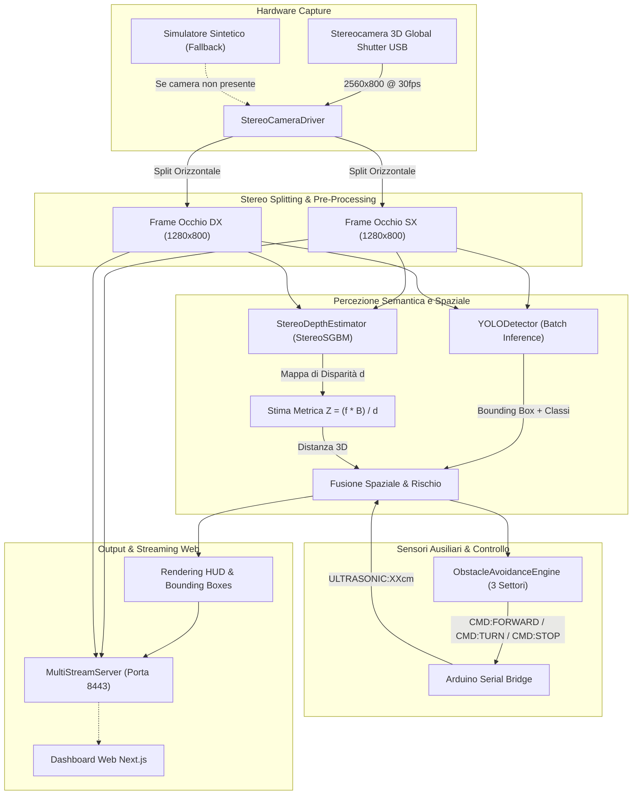

# 🏗️ Architettura del Sistema di Stereovisione 3D — M.A.R.

Il modulo `stereovisione` costituisce l'organo di **percezione visiva attiva e comprensione spaziale 3D** del robot quadrupede bio-ispirato **M.A.R. (Multi-legged Autonomous Robot)** su Raspberry Pi 5 / macOS.

---

## 📐 Flusso Computazionale e Pipeline dei Dati

La pipeline di elaborazione elabora flussi sincronizzati ad alta velocità combinando Computer Vision geometrica (disparità) e intelligenza artificiale semantica (YOLO):

---

## 🧩 Moduli Software

### 1. `camera/`
- **`StereoCameraDriver`**:
  - Auto-discovery su backend `AVFoundation` (macOS) e `V4L2` (Linux).
  - Configurazione hardware nativa per Global Shutter: disattivazione di autofocus ed auto-esposizione per prevenire artefatti e scatti durante i movimenti cinematici del quadrupede.
  - Generatore di streaming sintetico dinamico (`mock`) in caso di assenza dell'hardware fisico, consentendo lo sviluppo e i test continui dell'intera pipeline.
- **`StereoDepthEstimator`**:
  - Implementa l'algoritmo **StereoSGBM** (*Semi-Global Block Matching*) di OpenCV.
  - Calcola la disparità pixel per pixel tra occhio sinistro e destro.
  - Estrae la distanza reale in centimetri all'interno del ROI (Region of Interest) centrale dei bounding box rilevati.

### 2. `detector/`
- **`YOLODetector`**:
  - Gestione unificata di tutti i modelli YOLO supportati da Ultralytics (v5, v8, v9, v10, v11, v26+).
  - Supporto per tutte le dimensioni (nano `n`, small `s`, medium `m`, large `l`, extra-large `x`).
  - Ottimizzazione dell'inferenza tramite batch processing sincrono su coppia stereo `[frame_left, frame_right]`.
  - Rendering annotazioni con codice colore proporzionale al livello di rischio collisione.

### 3. `navigation/`
- **`ObstacleAvoidanceEngine`**:
  - Suddivide la visuale in **3 zone spaziali**: *Settore Sinistro*, *Corridoio Centrale Critico (Danger Zone)* e *Settore Destro*.
  - Ponderazione multi-fattore del rischio:
    $$Rischio = w_{US} \cdot Rischio_{Distanza} + (1 - w_{US}) \cdot Rischio_{Visivo}$$
  - Logica decisionale:
    - **EMERGENCY_STOP**: Rischio $\ge 3.5$ o $Z < 15-30\text{ cm}$.
    - **EVADE_LEFT / EVADE_RIGHT**: Rischio $\ge 2.5$; sterzata nel settore libero.
    - **SLOW_FORWARD**: Rischio $\ge 1.5$; rallentamento con cautela.
    - **FORWARD**: Corridoio libero a velocità nominale.

### 4. `server/`
- **`MultiStreamServer`**:
  - Server HTTP multi-thread ad altissime prestazioni scritto con `ThreadingHTTPServer` della libreria standard Python.
  - Zero latenza aggiuntiva: codifica JPEG asincrona e lock thread-safe.
  - Header **CORS** (`Access-Control-Allow-Origin: *`) per il rendering immediato nella web application Next.js.
  - Endpoint REST `/api/status` per telemetria, FPS e stato macchina.

### 5. `comms/`
- **`ArduinoSerialBridge`**:
  - Thread separato in background per l'ascolto non-bloccante della seriale USB.
  - Parsing automatico della telemetria (`ULTRASONIC:XXcm`, `TLM:...`, `ARDUINO_READY`).
  - Invio simultaneo del protocollo M.A.R. (`CMD:FORWARD,50`) e del carattere legacy (`F`) per massima compatibilità hardware.
  - **Fail-safe di chiusura**: all'arresto del processo Python invia tassativamente `CMD:STOP` / `S` per evitare movimenti incontrollati del quadrupede.
